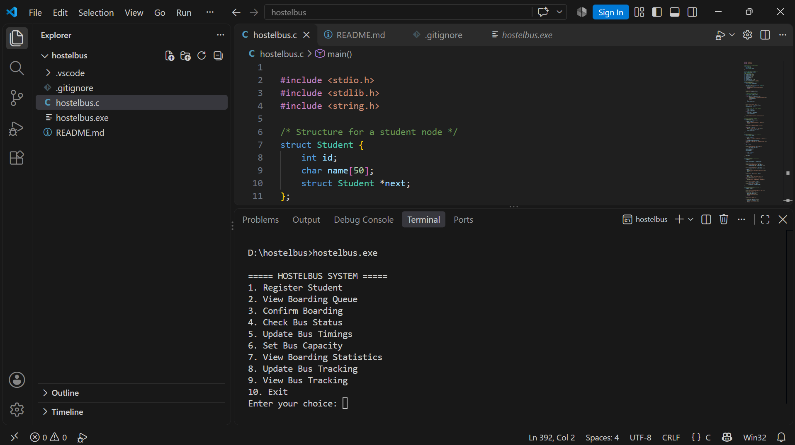

# HostelBus — Smart Bus Scheduling & Boarding Management System

A menu-driven C project designed to manage hostel bus boarding, seat capacity, departure delays, and manually updated bus tracking information.
## Screenshot



## Features

- **Student Registration:** Register students using their ID and name.
- **Duplicate ID Prevention:** Prevents duplicate student registrations.
- **Boarding Queue:** Uses a linked list to manage students in first-in, first-out order.
- **Boarding Management:** Confirm student boarding while respecting bus seat capacity.
- **Delay Tracker:** Compare scheduled and estimated departure times.
- **Bus Timing Updates:** Update scheduled and estimated departure times.
- **Seat Capacity Management:** Set the bus capacity and check available seats.
- **Boarding Statistics:** View registered students, boarded students, students waiting, and remaining seats.
- **Bus Status Tracker:** Update and view departure status, current location, and estimated arrival time.

## Technologies Used

- C programming language
- Structures and pointers
- Singly linked lists
- Functions and conditional statements
- Dynamic memory allocation

## Requirements

- GCC compiler
- A terminal or command prompt
- Visual Studio Code (recommended)

## How to Compile and Run

Open a terminal in the project folder and run:

```bash
gcc -std=c11 -Wall -Wextra -pedantic hostelbus.c -o hostelbus.exe
```

Then run the program in PowerShell:

```powershell
.\hostelbus.exe
```

## Bus Tracking Note

The current bus tracking feature uses manually entered status, location, and estimated arrival information. It does not use GPS or automatically retrieve the bus's real-time location.

## Project Purpose

This project demonstrates how fundamental C programming concepts and linked lists can be used to build a simple bus scheduling and boarding management system.

## Future Improvements

- Save student records between program runs.
- Add student search and cancellation.
- Support multiple buses and routes.
- Integrate GPS-based tracking in a future version.

---

**Project:** HostelBus  
**Language:** C  
**Status:** Beginner-level working prototype
